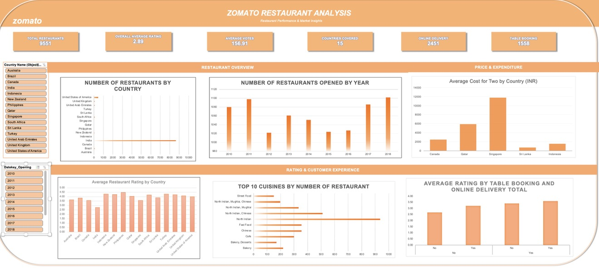

# Zomato Restaurant Data Analysis Dashboard

An interactive Excel dashboard exploring restaurant data across multiple countries, with a focus on ratings, cuisines, pricing, and service availability.

## Project Overview

This project uses Microsoft Excel to analyse restaurant data and present key metrics through an interactive dashboard. It explores differences in restaurant ratings, cuisine distribution, average cost, online delivery, and table-booking availability.

## Project Objectives

- Examine restaurant ratings across countries.
- Explore cuisine distribution and identify leading cuisines.
- Compare average restaurant costs across countries.
- Analyse online delivery and table-booking availability.
- Present key metrics in an interactive dashboard.

## Tools and Techniques

- Microsoft Excel
- Pivot Tables and Pivot Charts
- Excel formulas and lookup functions
- Data analysis and calculated fields
- KPI cards, charts, and interactive slicers
- Currency conversion for cross-country cost comparisons

## Dashboard Preview

## Key Analysis Areas

**Restaurant Ratings:** Explore average ratings and differences across countries.

**Cuisine Distribution:** Compare the representation of different cuisines in the dataset.

**Restaurant Pricing:** Examine average cost for two and compare costs across countries using INR conversion.

**Service Availability:** Analyse online delivery and table-booking availability.

## Key Findings

Restaurant ratings: The dataset's overall average rating was approximately 2.89 out of 5.

Online delivery: 2,451 of the 9,551 restaurants offered online delivery.

Delivery and ratings: Restaurants offering online delivery had a higher average rating than restaurants without it in this dataset.

Table booking and ratings: Restaurants offering table booking also had a higher average rating than those without it.

Note: These are descriptive findings from the dataset and do not establish that service availability causes higher ratings.

## Files Included

- `zomato-dashboard.jpeg` — Visual preview of the Excel dashboard.
- `Zomato_Restaurant_Analysis.xlsx` — Excel workbook containing the analysis and dashboard.

## Learning Outcomes

This project provided practical experience in Excel-based data analysis, dashboard development, data visualisation, calculated fields, and presenting structured data in a business-friendly format.

---

*Project completed as part of the Professional Certification in Data Science and Artificial Intelligence at Newton School.*
